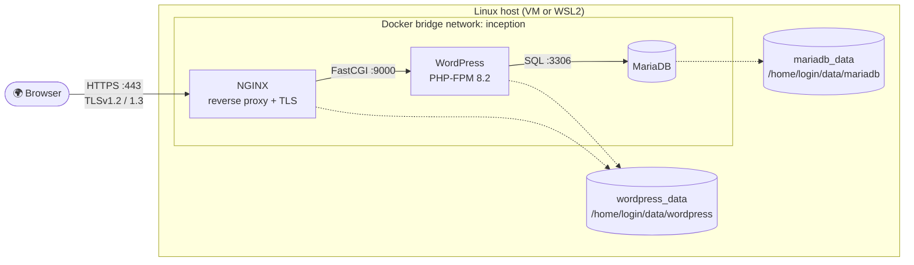

*This project has been created as part of the 42 curriculum by dbajeux.*

<!-- HEADER BANNER - same banner as the libft repository -->
<!-- <p align="center"></p> -->

<h1 align="center">Inception</h1>

<p align="center">
  A small production-like web infrastructure - <b>NGINX</b>, <b>WordPress + PHP-FPM</b> and <b>MariaDB</b> -
  each built from scratch in its own Docker container and orchestrated with Docker Compose.
</p>

<p align="center">
  
  
  
  
  
  
</p>

---

## Table of Contents

- [Description](#description)
- [Architecture](#architecture)
- [Instructions](#instructions)
- [Design Choices](#design-choices)
- [Technical Comparisons](#technical-comparisons)
- [Project Structure](#project-structure)
- [Resources](#resources)
- [Author](#-author)

📖 **[User documentation](USER_DOC.md)** - start, stop, access and check the services <br>
🔧 **[Developer documentation](DEV_DOC.md)** - environment setup, configuration, debugging

---

## Description

Inception is a system administration project: the goal is to build a small web infrastructure where every service runs in a **dedicated container built from my own Dockerfiles** - no ready-made images from Docker Hub, only the `debian:bookworm` base image.

**Key features**

- 🔒 **HTTPS only** - NGINX is the single entry point, on port `443`, with **TLSv1.2 / TLSv1.3** and a self-signed certificate generated at startup
- 🧱 **Three isolated services** - NGINX, WordPress + PHP-FPM (without NGINX) and MariaDB (without NGINX)
- 💾 **Persistent data** - two named volumes (database + website files) stored in `/home/<login>/data` on the host
- 🌐 **Private bridge network** - MariaDB and PHP-FPM are not reachable from outside the Docker network
- ⚙️ **Automated setup** - WordPress is downloaded, configured and installed by WP-CLI on first start, with an administrator and a second user (author role)
- 🔁 **Resilience** - containers restart automatically, and each service runs in the foreground as PID 1 (no `tail -f`, `sleep infinity` or infinite loops)
- 🛠️ **One-command deployment** - `make` checks the `.env`, configures `/etc/hosts`, creates the data directories, builds the images and starts the stack

---

## Architecture



| Container | Role | Port | Reachable from | Volume |
|---|---|---|---|---|
| `nginx` | TLS termination, serves static files, forwards `.php` requests to PHP-FPM | `443` | Outside (the only entry point) | `wordpress_data` |
| `wordpress` | Runs WordPress with PHP-FPM; installs and configures it with WP-CLI | `9000` | Docker network only (NGINX) | `wordpress_data` |
| `mariadb` | Stores the WordPress database; creates the database and user on first start | `3306` | Docker network only (WordPress) | `mariadb_data` |

---

## Instructions

### Prerequisites

- A Linux environment with `sudo` access - a Debian virtual machine, or WSL2 on Windows
- Docker Engine with the Compose plugin (`docker compose`)
- `make`

### Installation

```bash
git clone git@github.com:Mophe94/inception.git
cd inception

# Create your environment file from the template and fill in your values
cp srcs/.env.example srcs/.env
vim srcs/.env
```

> The real `srcs/.env` contains credentials: it is listed in `.gitignore` and must never be committed.

### Run

```bash
make
```

This single command runs `check-env → hosts → init → build → up`:

1. checks that `srcs/.env` exists and adapts the `/home/<login>/data` paths to the current user
2. adds the domain to `/etc/hosts` if it is not already there
3. creates the data directories on the host
4. builds the three images and starts the containers in the background

Then open **`https://<login>.42.fr`** and accept the self-signed certificate warning. The admin panel is at `https://<login>.42.fr/wp-admin`.

> **Browsing from Windows (WSL2)?** Windows does not read the Linux `/etc/hosts`: add `127.0.0.1 <login>.42.fr` to `C:\Windows\System32\drivers\etc\hosts` (as administrator).

| Command | Effect |
|---|---|
| `make` | Full setup, build and start |
| `make up` | Build (if needed) and start the containers |
| `make down` | Stop and remove the containers - **data is kept** |
| `make clean` | `down` + remove stopped containers |
| `make fclean` | Remove containers, images, volumes **and host data** ⚠️ |
| `make re` | `fclean` + `make` - full rebuild, **all data is lost** ⚠️ |

More details: [USER_DOC.md](USER_DOC.md) (usage) and [DEV_DOC.md](DEV_DOC.md) (development).

---

## Design Choices

**Base image - `debian:bookworm`.** The subject requires the penultimate stable version of Alpine or Debian. The project was originally built on Debian 11 (bullseye). When Debian 11 reached its end of life in August 2026 and its security repository was removed, the images no longer built, so they were moved to Debian 12 (bookworm), the current penultimate stable release (PHP 7.4 → 8.2). Images are always pinned to a version tag, never `latest`.

**One process per container, in the foreground.** Each image uses a Bash entrypoint that prepares the service and then calls `exec` (`nginx -g "daemon off;"`, `php-fpm8.2 -F`, `mysqld_safe`). The service replaces the script as PID 1 and receives Docker's stop signals directly.

**First-start setup.** The entrypoints only do the heavy work when it is needed:
- WordPress is only downloaded and installed if `wp-config.php` is missing
- the TLS certificate is only generated if it does not already exist
- MariaDB creates the database and user with `IF NOT EXISTS`

**Start-up ordering.** `depends_on` only orders container start-up, so the WordPress script also waits for the database to be ready (`mysqladmin ping`, 30 attempts) before running WP-CLI.

**Configuration through environment variables.** Every credential comes from `srcs/.env`, loaded with `env_file`. No password is written in a Dockerfile or committed to the repository; `srcs/.env.example` documents the expected variables.

---

## Technical Comparisons

### Virtual Machines vs Docker

| | Virtual machine | Docker container |
|---|---|---|
| Isolation | Full guest OS with its own kernel | Processes isolated on the host kernel (namespaces, cgroups) |
| Size / start-up | Gigabytes, minutes | Megabytes, seconds |
| Typical use | Run a different OS, strong isolation | Package and ship one service with its dependencies |

Here, the **VM** (or WSL2) provides an isolated Linux host, and **Docker** splits the stack into small, reproducible services inside it.

### Secrets vs Environment Variables

| | Docker secrets | Environment variables |
|---|---|---|
| Storage | Mounted as files in `/run/secrets/` | Injected into the process environment |
| Exposure | Not visible in `docker inspect` or the environment | Visible in `docker inspect` and to anything that can read the environment |
| Best for | Passwords, keys, certificates | Non-sensitive configuration (domain, user names, paths) |

This project uses **environment variables** loaded from a git-ignored `.env` file. Docker secrets would be the next step to harden it: Compose can mount file-based secrets without Swarm.

### Docker Network vs Host Network

| | Bridge network (used here) | Host network |
|---|---|---|
| Isolation | Containers get their own network stack | Containers share the host's network stack |
| Name resolution | Built-in DNS: containers reach each other by service name (`mariadb`, `wordpress`) | None between containers |
| Exposure | Only explicitly published ports (`443`) are reachable | Every listening port is exposed on the host |

The subject forbids `network: host`, `links` and `--link`. A user-defined bridge network keeps MariaDB and PHP-FPM private.

### Docker Volumes vs Bind Mounts

| | Named volume | Bind mount |
|---|---|---|
| Managed by | Docker (`docker volume ls`, `inspect`, `rm`) | The user, via a host path |
| Declared in | The top-level `volumes:` section | Directly in the service (`./path:/container/path`) |
| Typical use | Persistent application data | Sharing source or config files during development |

The subject requires **named volumes** with their data in `/home/<login>/data`. Both volumes are therefore named volumes using the `local` driver with `driver_opts` (`type: none`, `o: bind`, `device: ${…_DATA_PATH}`). Docker manages them, and the data stays at the required location on the host.

---

## Project Structure

```
inception/
├── Makefile                     # Setup and lifecycle automation
├── README.md                    # Project overview (this file)
├── USER_DOC.md                  # User / administrator guide
├── DEV_DOC.md                   # Developer reference
└── srcs/
    ├── .env.example             # Template for srcs/.env (the real file is git-ignored)
    ├── docker-compose.yml       # Services, volumes and network
    └── requirements/
        ├── mariadb/
        │   ├── Dockerfile
        │   ├── conf/50-server.cnf       # Listens on 0.0.0.0, utf8mb4
        │   └── tools/setup_mariadb.sh   # Creates the database and user, runs mysqld_safe
        ├── nginx/
        │   ├── Dockerfile
        │   ├── conf/nginx.conf          # TLSv1.2/1.3, FastCGI to wordpress:9000
        │   └── tools/setup_ssl.sh       # Generates the certificate, runs nginx
        └── wordpress/
            ├── Dockerfile
            ├── conf/www.conf            # PHP-FPM pool listening on :9000
            └── tools/setup_wordpress.sh # Installs WordPress with WP-CLI, runs php-fpm
```

---

## Resources

**Documentation**

- [Docker documentation](https://docs.docker.com/) · [Dockerfile reference](https://docs.docker.com/reference/dockerfile/) · [Compose file reference](https://docs.docker.com/reference/compose-file/)
- [Docker volumes](https://docs.docker.com/engine/storage/volumes/) · [Docker networking](https://docs.docker.com/engine/network/) · [Secrets in Compose](https://docs.docker.com/compose/how-tos/use-secrets/)
- [NGINX - configuring HTTPS servers](https://nginx.org/en/docs/http/configuring_https_servers.html)
- [WP-CLI](https://wp-cli.org/) · [MariaDB documentation](https://mariadb.com/kb/en/documentation/) · [PHP-FPM](https://www.php.net/manual/en/install.fpm.php)
- [Docker and the PID 1 zombie reaping problem](https://blog.phusion.nl/2015/01/20/docker-and-the-pid-1-zombie-reaping-problem/)

**AI usage**

AI assistants were used as learning and documentation tools:
- **Learning:** explaining Docker networking, volumes vs bind mounts, PID 1 behaviour and TLS configuration for NGINX
- **Review:** checking `docker-compose.yml` syntax and Dockerfile best practices
- **Documentation:** helping structure and review `README.md`, `USER_DOC.md` and `DEV_DOC.md`

The Dockerfiles, service configurations, setup scripts and architecture were written and tested by me.

---

## 👤 Author

**Dylan Bajeux** (`dbajeux`) - student at [42 Brussels](https://42belgium.be/fr/) (42 Network)

[](https://github.com/Mophe94)
[](https://www.linkedin.com/in/dylan-bajeux/)
